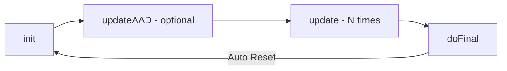

# 🔐 Deep Dive: `javax.crypto.Cipher` (JCE Architecture)

> **Модуль:** `java.base` | **Пакет:** `javax.crypto` | **JDK:** 1.4+ (Updated for JDK 21)  
> **Назначение:** Архитектурная документация, практический гайд и низкоуровневый справочник по работе с фреймворком криптографии Java.

---

## 📖 Словарь терминов (Простыми словами)

Перед погружением в код важно понимать базовые криптографические понятия:

* **SPI (Service Provider Interface)** — архитектурный паттерн в Java, позволяющий подключать разные реализации алгоритмов (провайдеры, например `SunJCE` или `BouncyCastle`) без изменения основного кода.
* **Трансформация (Transformation)** — строка-инструкция вида `"Алгоритм/Режим/Паддинг"`, которая говорит Java, как именно обрабатывать данные.
* **IV (Initialization Vector) / Nonce** — случайный вектор инициализации (одноразовое число). Нужен для того, чтобы при шифровании одинакового текста одним и тем же ключом каждый раз получался совершенно разный шифротекст.
* **AEAD (Authenticated Encryption with Associated Data)** — режим шифрования (например, `GCM`), который одновременно обеспечивает и конфиденциальность (зашифровывает данные), и подлинность (проверяет, не подменил ли кто-то данные).
* **AAD (Additional Authenticated Data)** — открытые метаданные (например, ID пользователя или хеш заголовка), которые не шифруются, но защищаются от подделки вместе с шифротекстом.
* **Padding (Паддинг)** — дополнение короткого блока данных «пустыми» байтами до фиксированного размера блока шифра (например, до 16 байт).

---

## 📌 Оглавление
- [1. Архитектура и инициализация](#1-архитектура-и-инициализация)
- [2. Пошаговое руководство: От инициализации до шифрования](#2-пошаговое-руководство-от-инициализации-до-шифрования)
- [3. Операционные режимы (opmode)](#3-операционные-режимы-opmode)
- [4. Жизненный цикл: Update vs DoFinal](#4-жизненный-цикл-update-vs-dofinal)
- [5. Оптимизация памяти и буферов](#5-оптимизация-памяти-и-буферов)
- [6. Дополнительная аутентификация (AAD)](#6-дополнительная-аутентификация-aad)
- [7. Ограничения юрисдикции](#7-ограничения-юрисдикции)
- [8. Справочник исключений](#8-справочник-исключений)

---

## 1. Архитектура и инициализация

Класс `Cipher` — ядро **Java Cryptographic Extension (JCE)**, построенное поверх паттерна **SPI** (*Service Provider Interface*).

### 🛠 Фабричные методы `getInstance`

```java
// 1. Поиск по приоритету зарегистрированных провайдеров (Рекомендуемый вариант)
Cipher c1 = Cipher.getInstance("AES/GCM/NoPadding");

// 2. Явный запрос у конкретного провайдера (Строковый идентификатор)
Cipher c2 = Cipher.getInstance("AES/GCM/NoPadding", "SunJCE");

// 3. Прямая передача инстанса провайдера
Cipher c3 = Cipher.getInstance("AES/GCM/NoPadding", myProvider);
```

> [!WARNING]
> **Production Best Practice:** Всегда передавайте полную строку трансформации (`Алгоритм/Режим/Паддинг`). Если передать только `"AES"`, провайдер подставит дефолтный режим (обычно уязвимый `ECB`), что создаст критическую дыру в безопасности.

---

## 2. Пошаговое руководство: От инициализации до шифрования

Разберем стандартный безопасный цикл работы с `Cipher` на примере `AES-256-GCM`.

### Шаг 1. Подготовка ключа и IV (Вектора инициализации)

```java
// 1. Генерация 256-битного секретного ключа
KeyGenerator keyGen = KeyGenerator.getInstance("AES");
keyGen.init(256);
SecretKey secretKey = keyGen.generateKey();

// 2. Генерация криптографически стойкого случайного IV (12 байт для GCM)
byte[] iv = new byte[12];
SecureRandom random = new SecureRandom();
random.nextBytes(iv);

// 3. Обертывание IV в спецификацию параметров GCM (128 бит длина тега аутентификации)
GCMParameterSpec parameterSpec = new GCMParameterSpec(128, iv);
```

### Шаг 2. Инициализация и шифрование (ENCRYPT_MODE)

```java
// Инициализируем Cipher для шифрования
Cipher cipher = Cipher.getInstance("AES/GCM/NoPadding");
cipher.init(Cipher.ENCRYPT_MODE, secretKey, parameterSpec);

byte[] plainText = "Hello, World! Секретные данные".getBytes(StandardCharsets.UTF_8);

// Завершаем шифрование за один вызов doFinal
byte[] cipherText = cipher.doFinal(plainText);
```

### Шаг 3. Расшифровка (DECRYPT_MODE)

```java
// Для расшифровки нужен тот же самый ключ и ТОТ ЖЕ IV
Cipher decryptCipher = Cipher.getInstance("AES/GCM/NoPadding");
GCMParameterSpec decryptSpec = new GCMParameterSpec(128, iv);

decryptCipher.init(Cipher.DECRYPT_MODE, secretKey, decryptSpec);

byte[] decryptedBytes = decryptCipher.doFinal(cipherText);
String decryptedText = new String(decryptedBytes, StandardCharsets.UTF_8);

System.out.println(decryptedText); // Выведет: "Hello, World! Секретные данные"
```

---

## 3. Операционные режимы (`opmode`)

При вызове метода `init()` объект шифра переводится в один из 4-х режимов:

| Режим | Константа | Назначение |
| :--- | :--- | :--- |
| **Encryption** | `Cipher.ENCRYPT_MODE` | Зашифрование открытых данных |
| **Decryption** | `Cipher.DECRYPT_MODE` | Расшифровка шифротекста |
| **Key Wrapping** | `Cipher.WRAP_MODE` | Безопасная упаковка (шифрование) другого ключа |
| **Key Unwrapping** | `Cipher.UNWRAP_MODE` | Распаковка ранее зашифрованного ключа |

При использовании `unwrap()` тип извлекаемого ключа строго типизируется:
- 🔑 `Cipher.SECRET_KEY` — Симметричные ключи (например, AES).
- 🔓 `Cipher.PRIVATE_KEY` — Приватные асимметричные ключи (RSA/ECC).
- 🔓 `Cipher.PUBLIC_KEY` — Публичные ключи.

---

## 4. Жизненный цикл: `Update` vs `DoFinal`

Для обработки больших объемов данных или потоков используется многочастная модель (*multi-part operation*).



1. **`update(...)`** — Пошаговая обработка порций байт. Возвращает промежуточный результат или `null`, если данных пока недостаточно для формирования блока.
2. **`doFinal(...)`** — Завершение операции. Применяет паддинг, рассчитывает (или валидирует) AEAD-тег аутентификации.

> [!IMPORTANT]
> Вызов `doFinal()` **автоматически сбрасывает** внутреннее состояние (State) объекта до состояния сразу после `init()`. Для режимов вроде `GCM` перед следующим шифрованием обязательна повторная инициализация с **новым IV**!

---

## 5. Оптимизация памяти и буферов

Для высоконагруженных систем (High-Load) предусмотрена интеграция с `java.nio.ByteBuffer` и прямое управление массивами байт.

- **`getOutputSize(int inputLen)`** — Точный расчет требуемого размера выходного буфера с учетом паддинга и AEAD-тега. Защищает от `ShortBufferException`.
- **Copy-Safe гарантия:** Методы `update` и `doFinal` позволяют использовать один и тот же массив байт в качестве входного и выходного буфера без риска затирания данных.

```java
// Оптимизированная обработка через ByteBuffer
ByteBuffer inputBuffer = ByteBuffer.wrap(plainTextBytes);
ByteBuffer outputBuffer = ByteBuffer.allocateDirect(cipher.getOutputSize(inputBuffer.remaining()));

cipher.doFinal(inputBuffer, outputBuffer);
```

---

## 6. Дополнительная аутентификация (`AAD`)

В AEAD-режимах (GCM/CCM) поддерживается передача данных, которые остаются открытыми, но защищаются тегом целостности (*Additional Authenticated Data*).

```java
byte[] metadataBytes = "user_id=12345".getBytes(StandardCharsets.UTF_8);

// Передача AAD строго до шифрования данных
cipher.updateAAD(metadataBytes);
byte[] cipherText = cipher.doFinal(plainText);
```

> [!CAUTION]
> **Архитектурный порядок:** Все вызовы `updateAAD()` должны строго **предшествовать** вызовам `update()` или `doFinal()`. Вызов AAD после начала передачи шифротекста выбросит `IllegalStateException`.

---

## 7. Ограничения юрисдикции

Методы для проверки разрешенной длины ключей в конкретной среде execution:

```java
// Возвращает Integer.MAX_VALUE при установленной Unlimited Strength Policy
int maxKeyLen = Cipher.getMaxAllowedKeyLength("AES");

// Возвращает ограничения параметров (или null, если ограничений нет)
AlgorithmParameterSpec maxSpec = Cipher.getMaxAllowedParameterSpec("AES/GCM/NoPadding");
```

---

## 8. Справочник исключений

<details>
<summary><b>📋 Развернуть таблицу исключений</b></summary>

| Исключение | Причина возникновения | Способ обработки / Профилактика |
| :--- | :--- | :--- |
| `InvalidKeyException` | Передан некорректный ключ или длина ключа превышает лимиты | Проверять размер ключа перед инициализацией |
| `InvalidAlgorithmParameterException` | Ошибка в параметрах (например, некорректный размер IV для GCM) | Для GCM передавать ровно 12 байт IV через `GCMParameterSpec` |
| `IllegalBlockSizeException` | Длина данных не кратна размеру блока (в режимах без паддинга) | Использовать паддинг или потоковые режимы |
| `BadPaddingException` | Поврежден паддинг при расшифровке (неверный ключ/данные) | Проверять валидность ключа шифрования |
| `AEADBadTagException` | Тег аутентификации GCM не совпал (данные были подменены) | Данные скомпрометированы. Отклонять пакет |
| `ShortBufferException` | Выходной буфер слишком мал для записи результата | Заранее запрашивать размер через `getOutputSize()` |

</details>