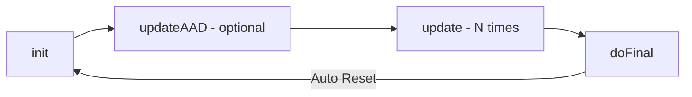

# 🔐 Deep Dive: `javax.crypto.Cipher` (JCE Architecture)

> **Модуль:** `java.base` | **Пакет:** `javax.crypto` | **JDK:** 1.4+ (Updated for JDK 21)  
> **Назначение:** Архитектурная документация и низкоуровневый справочник по работе с фреймворком криптографии Java.

---

## 📌 Оглавление
- [1. Архитектура и инициализация](#1-архитектура-и-инициализация)
- [2. Операционные режимы (opmode)](#2-операционные-режимы-opmode)
- [3. Жизненный цикл: Update vs DoFinal](#3-жизненный-цикл-update-vs-dofinal)
- [4. Оптимизация памяти и буферов](#4-оптимизация-памяти-и-буферов)
- [5. Дополнительная аутентификация (AAD)](#5-дополнительная-аутентификация-aad)
- [6. Ограничения юрисдикции](#6-ограничения-юрисдикции)
- [7. Справочник исключений](#7-справочник-исключений)

---

## 1. Архитектура и инициализация

Класс `Cipher` — ядро **Java Cryptographic Extension (JCE)**, построенное поверх паттерна **SPI** (*Service Provider Interface*).

### 🛠 Фабричные методы `getInstance`

```java
// 1. Поиск по приоритету зарегистрированных провайдеров (Рекомендуемый)
Cipher c1 = Cipher.getInstance("AES/GCM/NoPadding");

// 2. Явный запрос у конкретного провайдера (Строковый идентификатор)
Cipher c2 = Cipher.getInstance("AES/GCM/NoPadding", "SunJCE");

// 3. Прямая передача инстанса провайдера
Cipher c3 = Cipher.getInstance("AES/GCM/NoPadding", myProvider);
```

> [!WARNING]
> **Production Best Practice:** Всегда передавайте полную строку трансформации (`Алгоритм/Режим/Паддинг`). Если передать только `"AES"`, провайдер подставит дефолтный режим (обычно уязвимый `ECB`), что создаст критическую дыру в безопасности.

---

## 2. Операционные режимы (`opmode`)

При вызове метода `init()` объект шифра переводится в один из 4-х режимов:

| Режим | Константа | Назначение |
| :--- | :--- | :--- |
| **Encryption** | `Cipher.ENCRYPT_MODE` | Зашифрование открытых данных |
| **Decryption** | `Cipher.DECRYPT_MODE` | Расшифровка шифротекста |
| **Key Wrapping** | `Cipher.WRAP_MODE` | Безопасная упаковка (шифрование) другого ключа |
| **Key Unwrapping** | `Cipher.UNWRAP_MODE` | Распаковка ранее зашифрованного ключа |

При использовании `unwrap()` тип извлекаемого ключа строго типизируется:
- 🔑 `Cipher.SECRET_KEY` — Симметричные ключи (например, AES).
- 🔓 `Cipher.PRIVATE_KEY` — Приватные асимметричные ключи (RSA/ECC).
- 🔓 `Cipher.PUBLIC_KEY` — Публичные ключи.

---

## 3. Жизненный цикл: `Update` vs `DoFinal`

Для обработки больших объемов данных или потоков используется многочастная модель (*multi-part operation*).



1. **`update(...)`** — Пошаговая обработка порций байт. Возвращает промежуточный результат или `null`, если данных пока недостаточно для формирования блока.
2. **`doFinal(...)`** — Завершение операции. Применяет паддинг, рассчитывает (или валидирует) AEAD-тег аутентификации.

> [!IMPORTANT]
> Вызов `doFinal()` **автоматически сбрасывает** внутренний State объекта до состояния сразу после `init()`. Для режимов вроде `GCM` перед следующим шифрованием обязательна повторная инициализация с **новым IV**!

---

## 4. Оптимизация памяти и буферов

Для высоконагруженных систем (High-Load) предусмотрена интеграция с `java.nio.ByteBuffer` и прямое управление массивами байт.

* **`getOutputSize(int inputLen)`** — Точный расчет требуемого размера выходного буфера с учетом паддинга и AEAD-тега. Защищает от `ShortBufferException`.
* **Copy-Safe гарантия:** Методы `update` и `doFinal` позволяют использовать один и тот же массив байт в качестве входного и выходного буфера без риска затирания данных.

```java
// Оптимизированная обработка через ByteBuffer
ByteBuffer inputBuffer = ...;
ByteBuffer outputBuffer = ByteBuffer.allocateDirect(cipher.getOutputSize(inputBuffer.remaining()));

cipher.doFinal(inputBuffer, outputBuffer);
```

---

## 5. Дополнительная аутентификация (`AAD`)

В AEAD-режимах (GCM/CCM) поддерживается передача данных, которые остаются открытыми, но защищаются тегом целостности (*Additional Authenticated Data*).

```java
// Передача AAD
cipher.updateAAD(metadataBytes);
```

> [!CAUTION]
> **Архитектурный порядок:** Все вызовы `updateAAD()` должны строго **предшествовать** вызовам `update()` или `doFinal()`. Вызов AAD после начала передачи шифротекста выбросит `IllegalStateException`.

---

## 6. Ограничения юрисдикции

Методы для проверки разрешенной длины ключей в конкретной среде execution:

```java
// Возвращает Integer.MAX_VALUE при установленной Unlimited Strength Policy
int maxKeyLen = Cipher.getMaxAllowedKeyLength("AES");

// Возвращает ограничения параметров (или null, если ограничений нет)
AlgorithmParameterSpec maxSpec = Cipher.getMaxAllowedParameterSpec("AES/GCM/NoPadding");
```

---

## 7. Справочник исключений

<details>
<summary><b>📋 Развернуть таблицу исключений</b></summary>

| Исключение | Причина возникновения | Способ обработки / Профилактика |
| :--- | :--- | :--- |
| `InvalidKeyException` | Передан некорректный ключ или длина ключа превышает лимиты | Проверять размер ключа перед инициализацией |
| `InvalidAlgorithmParameterException` | Ошибка в параметрах (например, некорректный размер IV для GCM) | Для GCM передавать ровно 12 байт IV через `GCMParameterSpec` |
| `IllegalBlockSizeException` | Длина данных не кратна размеру блока (в режимах без паддинга) | Использовать паддинг или потоковые режимы |
| `BadPaddingException` | Поврежден паддинг при расшифровке (неверный ключ/данные) | Проверять валидность ключа шифрования |
| `AEADBadTagException` | Тег аутентификации GCM не совпал (данные были подменены) | Данные скомпрометированы. Отклонять пакет |
| `ShortBufferException` | Выходной буфер слишком мал для записи результата | Заранее запрашивать размер через `getOutputSize()` |

</details>
